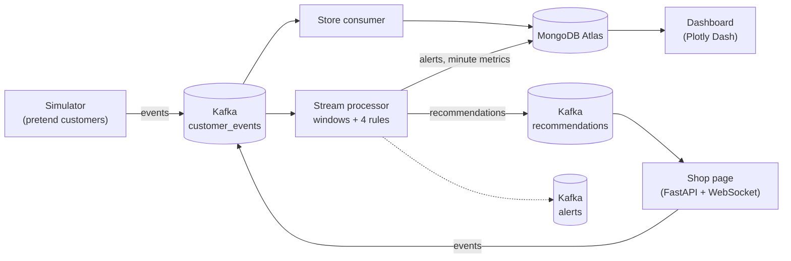
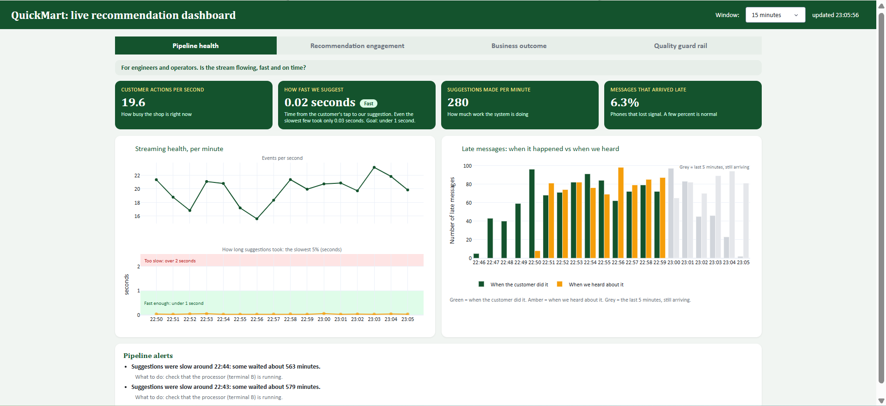
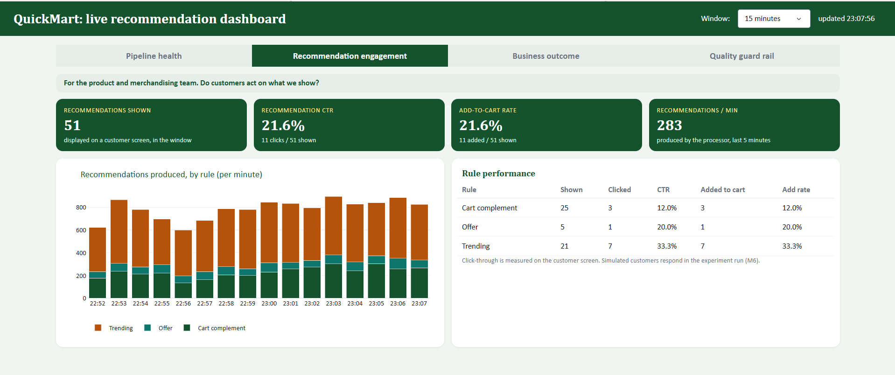
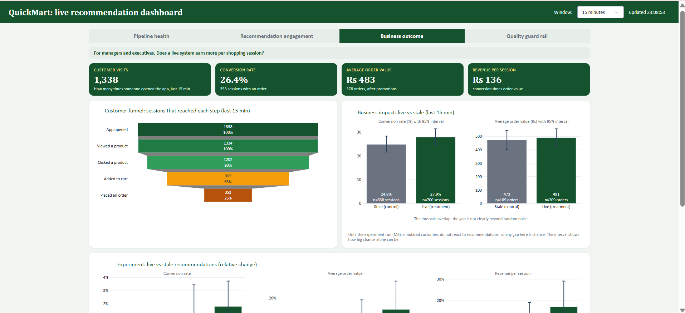
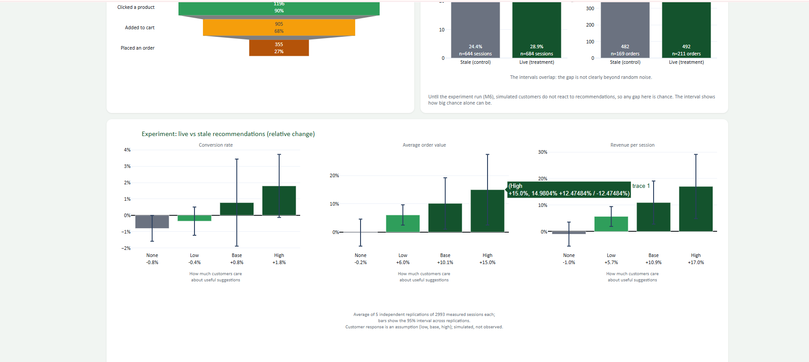
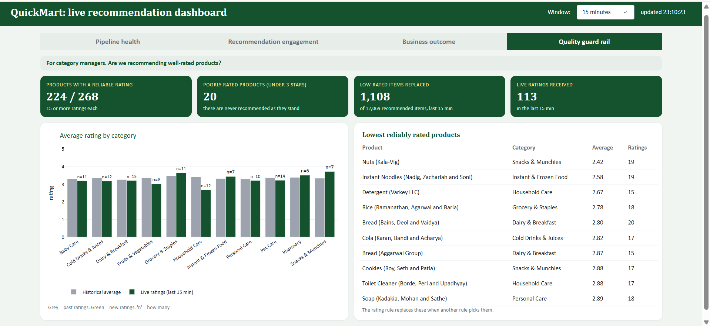
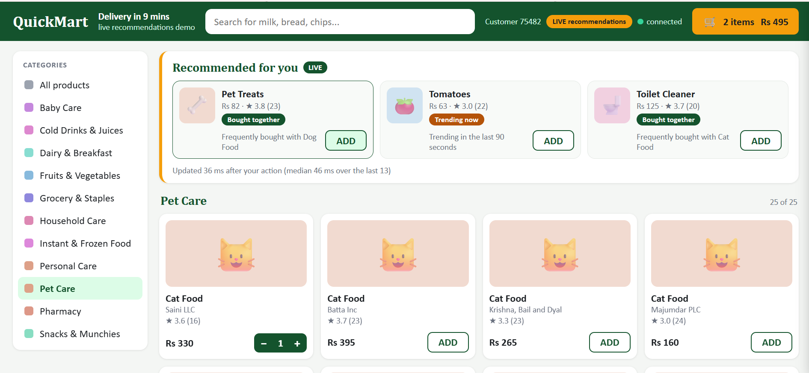
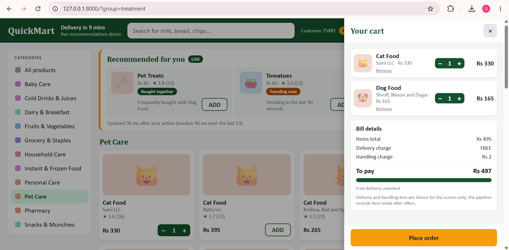
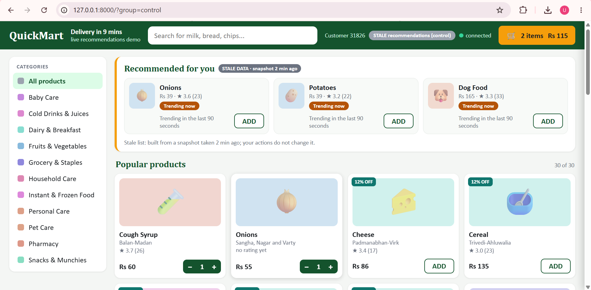

# QuickMart: real-time recommendations for a quick-commerce app

An end-to-end **streaming analytics** project. Customer actions in a grocery-delivery app flow through **Kafka**, a **Python stream processor**
turns them into live recommendations (each with a visible reason), and a **live dashboard** shows how the system and the recommendations perform.
An offline experiment compares **live** recommendations with **stale** (hourly snapshot) ones.

> Streaming Data Analytics, final project. The customers are **simulated**, so the speed and correctness are measured, and the business impact is a scenario estimate.

## What it does

- A shop screen shows recommendations that change within a fraction of a second of the customer's action (about 20 ms in our runs on a laptop at 20 events/second).
- Four rules decide what to suggest: *bought together*, *offer / free delivery*, *trending* (a sliding time window), and a *rating* check that swaps out poorly rated products.
- A four-tab dashboard (pipeline health, recommendation engagement, business outcome, quality guard rail) reads the results from MongoDB and refreshes every 3 seconds.
- Late events (a phone that was offline) are counted in the minute they happened, not the minute they arrived.
- An offline experiment (five independent replications) estimates how much more a visit earns with live recommendations, under four assumptions about how much customers care about relevance.

## Architecture



| Kafka topic | Content | Written by | Read by |
| --- | --- | --- | --- |
| `customer_events` | every customer action (keyed by customer, 3 partitions) | simulator, shop server | store consumer, processor |
| `recommendations` | each suggestion list with its reasons | processor | shop server (pushed to the page over a WebSocket) |
| `alerts` | slow-system and late-message warnings | processor | nothing yet (the dashboard reads the MongoDB copy) |

## Tech stack

Python 3.12+ · Apache Kafka 3.9 (KRaft, single node) · MongoDB Atlas (free tier) · FastAPI + WebSocket · Plotly Dash · pandas, NumPy

## Results

**Measured on the pipeline (one laptop, about 20 events/second):** recommendation latency about 22 ms on average and 42 ms at the 95th percentile (processor only; the shop screen shows its own full round trip, usually 50 to 200 ms).

**Estimated by the experiment** (live vs stale recommendations, relative change; average of 5 independent replications of about 2,993 visits each; 95% interval across replications):

| Customers care about relevance... | Conversion rate | Average order value | Revenue per visit |
| --- | --- | --- | --- |
| None | -0.8% (-1.6% to -0.0%) | -0.2% (-5.0% to +4.6%) | -1.0% (-5.6% to +3.5%) |
| Low | -0.4% (-1.2% to +0.5%) | +6.0% (+2.5% to +9.6%) | +5.7% (+1.9% to +9.4%) |
| Base | +0.8% (-1.9% to +3.4%) | +10.1% (+1.1% to +19.2%) | +10.9% (+2.8% to +19.0%) |
| High | +1.8% (-0.1% to +3.7%) | +15.0% (+2.5% to +27.5%) | +17.0% (+4.9% to +29.1%) |

How to read it: if customers do not care about relevance, live recommendations earn no more than stale ones. The more they care, the more each visit earns, mainly through **bigger baskets**, not more buyers. How much customers care is an **assumption**, so treat this as a range, not a forecast.

## Data: what is supplied, what is simulated, what is assumed

| | What |
| --- | --- |
| **Supplied** | A Kaggle sample dataset modelled on a quick-commerce app (not Blinkit's own data): 268 products, 2,500 customers, 5,000 past orders (one item each) and 5,000 ratings. See `data/` |
| **Changed** | Prices. The supplied prices are synthetic, so `make_realistic_prices.py` draws a plausible price per product inside a band per product name (`PRICE_BANDS` in `config.py`). These bands are approximations, not Blinkit's prices |
| **Simulated** | All live behaviour (opening the app, viewing, tapping, carts, orders, ratings), multi-item baskets, late events (about 7%) and offers |
| **Assumed** | How customers react to suggestions. Only the 10% base tap rate comes from data (the campaign file). Every other number is a choice, all in `config.py` |

## Quick start

Requirements: Python 3.12+, Java 17, Kafka 3.9, a free MongoDB Atlas cluster. Windows steps: [`docs/SETUP_NEW_LAPTOP.md`](docs/SETUP_NEW_LAPTOP.md).

```bash
python -m venv venv
venv\Scripts\activate            # macOS/Linux: source venv/bin/activate
pip install -r requirements.txt
copy .env.example .env           # then put your Atlas connection string in .env
python m1_load_data.py           # loads the data into MongoDB (safe to re-run)
```

Start Kafka, then each of these in its own terminal, in this order:

```bash
python m2_create_topics.py                                    # once
python m2_store_consumer.py                                   # A: saves events
python m3_processor.py --trend-window 90 --trend-slide 2 --stale-refresh 300   # B: the recommender
python m2_producer.py --rate 20                               # C: pretend customers
python m4_app.py                                              # D: shop  http://127.0.0.1:8000/?group=treatment
python m5_dashboard.py                                        # E: dashboard  http://127.0.0.1:8050
```

Wait about 6 minutes so the stale snapshot has data. `?group=control` shows the stale page.
Load the experiment results into the dashboard with `python m6_load_results.py`; re-run the experiment with `python m6_experiment.py` (several minutes, no Kafka needed).
Run the rule tests with `python m3_rule_tests.py`. Clear the stored run data with `python m5_reset.py` (the free Atlas tier holds 512 MB).

The shop page alone, with no Kafka and no MongoDB: `python m4_ui_dev.py`.

## Screenshots

### Dashboard
| Pipeline health | Recommendation engagement |
| --- | --- |
|  |  |

| Business outcome (1) | Business outcome (2) |
| --- | --- |
|  |  |

| Quality guard rail |
| --- |
|  |

### Shop screen
| Live Recommendations 1 | Live Recommendations 2 | Stale recommendations |
| --- | --- | --- |
|  |  |  |

## Repository map

| File | Role |
| --- | --- |
| `config.py` | Every setting, threshold and assumption in one place |
| `m1_load_data.py`, `make_realistic_prices.py` | Load and prepare the data |
| `simulator.py`, `m2_producer.py`, `m2_trend_burst.py` | Pretend customers, the event stream and the "sudden trend" demo |
| `m2_store_consumer.py`, `m2_create_topics.py`, `m2_check.py` | Kafka topics and the consumer that stores events |
| `recommender.py`, `m3_processor.py`, `m3_rule_tests.py` | The recommendation rules, the stream processor and its tests |
| `m4_app.py`, `web/index.html`, `m4_ui_dev.py` | The shop screen (FastAPI, WebSocket) |
| `m5_dashboard.py`, `dashboard_data.py`, `m5_reset.py` | The four-tab dashboard and its queries |
| `interactive.py`, `m6_experiment.py`, `m6_load_results.py`, `results/` | The live-vs-stale experiment and its saved results |
| `docs/` | Setup guides, the dashboard explained in plain words (PDF), the shop-screen API contract |

The `m1` to `m6` prefixes are the build order, not a package structure.

## Limitations

- Customers are simulated and the data is a synthetic sample, so absolute rupee values mean little. Use the relative changes.
- The experiment's result depends on the assumed effect of relevance (four scenarios), and it changes a little between runs.
- Everything runs on one node: one Kafka broker, one processor. The design scales by adding partitions and consumers, but we only measured about 20 events/second.
- The dashboard runs only while its program runs; there is no login or hosted link.
- The `alerts` topic has no subscriber yet.

## Possible next steps

Real clickstream data in place of the simulator, a reorder-reminder and a stock-aware rule, more partitions and consumers for higher volume, hosted dashboards with alerting.

## Credits and licence

Code: MIT, see `LICENSE`. The sample dataset in `data/` comes from a Kaggle dataset; check its licence before reuse.
